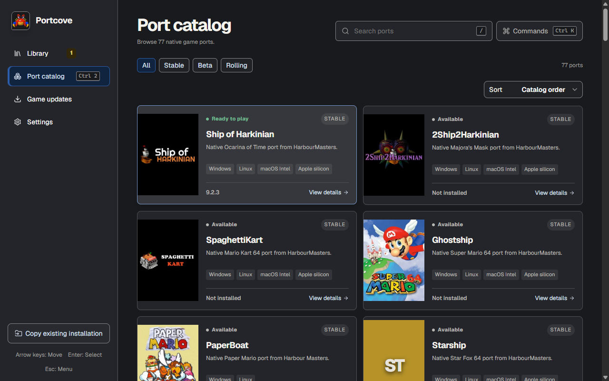

<p align="center">
  
</p>

<h1 align="center">Portcove</h1>

<p align="center">
  Install, update, and play native game ports.
</p>

<p align="center">
  <a href="#project-status">Project status</a> ·
  <a href="https://github.com/boburning/portcove/releases">Download</a> ·
  <a href="#build-from-source">Build from source</a> ·
  <a href="docs/README.md">Documentation</a> ·
  <a href="https://github.com/users/boburning/projects/1">Roadmap</a>
</p>

Portcove brings native game ports into one local library. Choose a port, add the
game files it needs, and use the desktop app or command-line tool to manage
supported installations, updates, and backups. Some ports use an existing
installation rather than installing or updating files through Portcove.



_Windows development build, October 1, 2026: an installed game, available ports,
and real mixed artwork. This is the application, not a mockup; the pictured
design and default covers are newer than the published Alpha 2 preview._

Existing Alpha 1 libraries can be carried forward with the documented
[upgrade and recovery procedure](docs/UPGRADING.md).

> [!NOTE]
> Portcove does not include or download ROMs, disc images, BIOS files, or other
> copyrighted game data. It checks game files locally and does not
> upload them. You can use their current location, copy them into Portcove, or
> explicitly move them after reviewing the consequences. A completed Move
> removes the original only after a verified managed copy is registered.

## What Portcove does

### For players

- Browse a catalog of native ports and manage them as one library. Explicitly
  check game-file availability for a selected route, platform and channel, then
  combine current observations with catalog filters. Details explain the same
  observation; setup and launch still use their ordinary reviews.
- Keep managed versions side by side so updates can be saved for later, installed,
  checked, or rolled back.
- Install suitable upstream portable packages with the same managed update and
  recovery lifecycle. Upstream software can handle its own first-launch setup;
  installation review explains who updates the runtime and where player data lives.
- Get a recommended upstream release, package and download folder for simpler
  setup routes, or register an existing installation while keeping its files and
  update workflow under your control.
- Adopt an existing installation by copying it into Portcove without changing the original.

### Library safety

- Check game files locally. A saved location can point to the
  current file; copying into Portcove leaves the original in place, while Move
  requires separate authorization. Portcove checks known exact identities and
  records a local baseline to detect later changes.
- Check downloaded files against the expected checksum before installing them.
  Current hosted releases use provider digests or checksum sidecars; accepted
  direct manifests pin exact artifacts. Catalog-curated acquisition is planned
  under [#315](https://github.com/boburning/portcove/issues/315).
- Keep the saved data declared for a port, such as its known save, settings, and
  mod locations, separately from installed versions; back up and restore that
  managed data. This does not establish save compatibility across game versions.

### Launcher use

- Launch an installed port through the desktop app or the standalone CLI, with
  the selected library and Portcove's current launch checks.
- Connect another launcher through the [public integration routes](docs/INTEGRATIONS.md).
  Launch-only, library and lifecycle integrations have different capabilities;
  a named launcher is not a claim that its complete plugin is supported.

### Developer and integration support

- Use the shared Core behavior through Desktop or the independent CLI.
- Discover versioned JSON/JSONL, schemas, capabilities and stable error/exit
  behavior through the [CLI guide](docs/CLI.md) and
  [external-author workflow](docs/INTEGRATION-AUTHOR.md).

Portcove keeps its library, saved game-file locations, and application state
local. A GitHub account is optional and is used only to raise the API rate
limit; startup and launching do not depend on an account or a Portcove-hosted
service.

## Project status

> [!WARNING]
> **Latest technical preview: Alpha 2 — onboarding and storage**
>
> Portcove is under active development. It is intended for maintainers and technically comfortable testers using disposable or fully backed-up libraries—not general users or irreplaceable setups.

[Portcove 0.1.0-alpha.2](https://github.com/boburning/portcove/releases/tag/v0.1.0-alpha.2)
is released as an immutable prerelease. It adds first-play source onboarding,
safe Copy and authorized Move intake, shared tool setup, library and per-game
storage controls, recoverable relocation, and the documented Alpha 1 upgrade
path. Alpha 1 remains available with its frozen release evidence.

A port appearing in the catalog does **not** mean every platform has completed hands-on testing. Upstream availability, automated checks, and Portcove's own manual testing are tracked separately for each port and platform.

Current priorities and blockers live in the public [Portcove Roadmap](https://github.com/users/boburning/projects/1). The meaning of Alpha, Beta, RC, and V1 lives in [docs/ROADMAP.md](docs/ROADMAP.md). The catalog can continue growing without turning every newly discovered port into a V1 blocker.

## Download the technical alpha

For the graphical app, choose a **Desktop** package for your operating system
and processor from the [Alpha 2 release](https://github.com/boburning/portcove/releases/tag/v0.1.0-alpha.2).
For terminal use, choose the separate **CLI** archive. The desktop app does not
require that archive, and the CLI archive is not a graphical app. GitHub's
generated **Source code** archives are for building Portcove yourself.

| System                            | Desktop package                                                                                                                                                                                                                                                                                                                                                                                                                                          | Standalone CLI archive                                                                                                                |
| --------------------------------- | -------------------------------------------------------------------------------------------------------------------------------------------------------------------------------------------------------------------------------------------------------------------------------------------------------------------------------------------------------------------------------------------------------------------------------------------------------- | ------------------------------------------------------------------------------------------------------------------------------------- |
| Windows x64                       | [Portcove_0.1.0-alpha.2_x64-setup.exe](https://github.com/boburning/portcove/releases/download/v0.1.0-alpha.2/Portcove_0.1.0-alpha.2_x64-setup.exe)                                                                                                                                                                                                                                                                                                      | [portcove-windows-x86_64.zip](https://github.com/boburning/portcove/releases/download/v0.1.0-alpha.2/portcove-windows-x86_64.zip)     |
| Linux x64, experimental           | [Portcove_0.1.0-alpha.2_amd64.AppImage](https://github.com/boburning/portcove/releases/download/v0.1.0-alpha.2/Portcove_0.1.0-alpha.2_amd64.AppImage), [Portcove_0.1.0-alpha.2_amd64.deb](https://github.com/boburning/portcove/releases/download/v0.1.0-alpha.2/Portcove_0.1.0-alpha.2_amd64.deb), or [Portcove-0.1.0-alpha.2-1.x86_64.rpm](https://github.com/boburning/portcove/releases/download/v0.1.0-alpha.2/Portcove-0.1.0-alpha.2-1.x86_64.rpm) | [portcove-linux-x86_64.tar.gz](https://github.com/boburning/portcove/releases/download/v0.1.0-alpha.2/portcove-linux-x86_64.tar.gz)   |
| macOS Intel, experimental         | [Portcove_0.1.0-alpha.2_x64.dmg](https://github.com/boburning/portcove/releases/download/v0.1.0-alpha.2/Portcove_0.1.0-alpha.2_x64.dmg)                                                                                                                                                                                                                                                                                                                  | [portcove-macos-x86_64.tar.gz](https://github.com/boburning/portcove/releases/download/v0.1.0-alpha.2/portcove-macos-x86_64.tar.gz)   |
| macOS Apple silicon, experimental | [Portcove_0.1.0-alpha.2_aarch64.dmg](https://github.com/boburning/portcove/releases/download/v0.1.0-alpha.2/Portcove_0.1.0-alpha.2_aarch64.dmg)                                                                                                                                                                                                                                                                                                          | [portcove-macos-aarch64.tar.gz](https://github.com/boburning/portcove/releases/download/v0.1.0-alpha.2/portcove-macos-aarch64.tar.gz) |

These are the published Alpha 2 choices; check the selected release page for
later versions and their limitations. Application upgrades are manual. Before
opening an existing library, follow the [upgrade and recovery
steps](docs/UPGRADING.md). Read the [Alpha 2 release
notes](docs/releases/0.1.0-alpha.2-release-notes.md) for package scope and
known limitations.

Windows packages are unsigned; macOS packages are unsigned and not notarized.
Keep operating-system security protections enabled. Linux and macOS remain
experimental, with hosted build/test evidence and incomplete hands-on package
qualification. [Verify the download and read the signing/SBOM limits](docs/DOWNLOADS.md)
before opening it.

## Your first game

Use a disposable or backed-up library for this technical preview.

The screenshots show the current development build. In the published Alpha 2
app, **Review install** presents the plan inline, and the launch action is
**Play now** or **Complete setup and play**. The newer build uses the labels
below and a separate installation-review dialog.

1. Open **Portcove Desktop** and choose the local library you intend to use.
2. Open **Port catalog**, choose a port, and read its game-file requirements and
   recorded platform evidence. A catalog entry alone does not establish support.
3. Choose your own required game files, or enter their local path. Portcove
   checks them locally when you continue installation. An unsupported or changed
   input needs attention; do not substitute another edition blindly.
4. Choose **Review installation**. Check the version, download size and install
   folder, then confirm **Install**. Wait for verification and preparation to finish.
5. When the game is **Ready to play**, choose **Play**. Some ports perform their
   own first-launch preparation or ask a further question. Close the game normally
   to return to Portcove.

This [captured Windows development-build journey](docs/media/first-play/README.md)
shows Ship of Harkinian installing from a verified package, recognizing an exact
Ocarina of Time source, preparing its game data, and reaching the title screen.
It is separate from Alpha 2 package qualification and does not establish gameplay,
audio, save compatibility or physical-controller behavior.

## Manage, check, update and recover

Use the selected port's requirements and current state to choose the next action.
These CLI examples describe the maintained development contract; check your
selected package's `--help` and capabilities before using a newer command. The
[CLI task guide](docs/CLI.md) separates current source behavior from published
preview limitations.

| Task                        | Start here                                                                                                      | What the result means                                                                                                                                         |
| --------------------------- | --------------------------------------------------------------------------------------------------------------- | ------------------------------------------------------------------------------------------------------------------------------------------------------------- |
| Inspect a library or port   | Open Library/game details, or run `portcove status PORT_ID`.                                                    | Current installation and action assessments; reading them does not authorize or execute a change.                                                             |
| Check installed files       | Run `portcove verify PORT_ID`.                                                                                  | Installed files are compared with their recorded identities. This does not test gameplay or save compatibility.                                               |
| Check original game files   | Use Game files in Settings, or `portcove source inspect PROFILE_ID` and `portcove source verify PROFILE_ID`.    | Inspection and baseline comparison are distinct from compatibility with a particular installed release. Original bytes and the saved baseline stay unchanged. |
| Check for a game update     | Run `portcove check PORT_ID`, or use the game's update check.                                                   | An update check does not install it. Review the current release, policy and consequences before installation or activation.                                   |
| Protect managed saved data  | Use the port's backups, or `portcove backup create PORT_ID` followed by `portcove backup list PORT_ID`.         | The backup covers declared managed saved data, not the game download or original inputs. Restore replaces the affected current saved data after review.       |
| Correct a moved game file   | Use Update file location in Game files, or the [reviewed relink route](docs/CLI.md#find-and-relink-game-files). | The new location must still match the registered content; relinking does not move files or accept changed bytes.                                              |
| Recover an interrupted task | Read Activity and `portcove doctor`, then follow the operation's reported recovery action.                      | Diagnosis does not itself resume or clean up an operation. Retained files or an unknown outcome need the specific supported recovery.                         |
| Upgrade Portcove itself     | Follow [application upgrade and recovery](docs/UPGRADING.md).                                                   | Published Alpha 2 upgrades are manual. An application update is separate from a game update or catalog refresh.                                               |

Bulk `check --all`, `reconcile --all` and `update --all` continue after a
per-port failure and report each outcome. A completed batch can contain failed
ports; inspect every result. `reconcile` follows each saved update policy and
can download or activate a release, while `check` only checks. Saving a policy
does not execute it.

Cancellation is a request. Downloads and hashing stop cooperatively; a current
conversion or build step may need to settle, and an admitted publication can
finish. Wait for the operation's terminal result and read any recovery guidance.
See [safe cancellation](docs/CLI.md#cancel-work-safely) and
[interrupted library transfers](docs/CLI.md#recover-an-interrupted-transfer).
Desktop and CLI share library locks and recovery rules; close other clients
before a whole-library transfer.

### Optional disc tools

Some declared disc formats or preparation routes need a local `chdman` or
`DolphinTool`. Other ports do not. `portcove tool list` reports each tool's purpose,
resolution and official setup reference; `portcove doctor` reports missing or
misconfigured prerequisites. Configure a trusted executable only when the
selected route requires it. Portcove does not silently download these executables
or modify the original disc image. See [disc-format requirements](docs/CLI.md#disc-formats-and-optional-tools).

## GitHub access

### Anonymous use

An account is optional. Browsing public releases and ordinary local library use
work without signing in; public GitHub requests remain subject to GitHub's
request limits. Startup and launching do not require an account.

### Personal access token

Use `portcove auth set-token` to enter a token with hidden input, or the
documented standard-input/environment route for automation. Tokens are not
accepted as positional command arguments. Saved credentials use the operating
system's credential store. See [GitHub authentication](docs/CLI.md#github-authentication).

### Device sign-in

`portcove auth login` starts the configured GitHub device flow. Follow the
displayed instructions; the CLI follows the required polling interval and
reports denial, expiry or cancellation. `portcove auth status` shows the active
credential source without exposing the token; `portcove auth logout` removes a
saved credential, but cannot remove an environment-provided token.

Authentication raises the GitHub API allowance. It does not supply game files,
bypass their checks or change a port's support evidence.

## Catalog and support

The catalog changes too quickly for a hand-maintained count or title list here. Browse it in the desktop app, through the CLI, or directly in [`catalog.json`](crates/portcove-core/catalog/catalog.json).

```text
portcove catalog list
portcove catalog show <port-id>
portcove --json catalog export
```

Each entry records its upstream project, platforms, release channels, required local files, executable layout, user-data paths, and current test evidence. Stable, Preview, and Rolling are game-port release channels—not quality ratings. Preview retains the `beta` command and serialized value. See [docs/CATALOG.md](docs/CATALOG.md) for the full policy.

## Build from source

### Prerequisites

- Rust at the version specified in [`rust-toolchain.toml`](rust-toolchain.toml)
- [Global Vite+](https://viteplus.dev/guide/global-cli) with environment management
  enabled, to select Node from [`.node-version`](.node-version) and pnpm from
  [`package.json`](package.json). An existing manager providing those exact versions
  also works; there is no separate Portcove Node installation.
- the [Tauri 2 platform prerequisites](https://v2.tauri.app/start/prerequisites/)

Development storage defaults are portable: a checkout may use the Windows system drive when its physical paths and free capacity pass preflight. Prefer an SSD for fixture-heavy work. A stricter machine-local policy can impose additional restrictions without changing repository defaults. See [docs/DEVELOPMENT-STORAGE.md](docs/DEVELOPMENT-STORAGE.md) for the storage checks and private-policy boundary.

From the repository root, set up frontend dependencies and hooks, then run the
desktop app. Repeat setup after pulling toolchain changes; it refreshes hooks
even when dependencies are already installed.

```powershell
node scripts/dev-storage.mts preflight
./scripts/bootstrap-quality-tools.ps1 -Profile frontend
node scripts/dev-storage.mts run -- pnpm --dir apps/desktop desktop:dev
```

On Linux/macOS, use `./scripts/bootstrap-quality-tools.sh --profile frontend`
for the setup step. `vp env install` explicitly provisions the checkout's Node
and pnpm when needed; `vp env current` shows the selected versions. See
[development setup](docs/DEVELOPMENT-TOOLS.md#frontend-workflow) for daily and
Core-only profiles.

Build the CLI using the repository storage wrapper:

```powershell
node scripts/dev-storage.mts run -- cargo build -p portcove-cli --release
```

The documented command requires Node.js to run the storage wrapper and preserve
the repository storage checks and configured paths. The underlying Cargo build
compiles `portcove-cli` and `portcove-core`; compilation itself does not require
Node.js, pnpm, Tauri CLI, WebView, or frontend packages, and does not build the
desktop UI. Keep the storage wrapper for repository development.

Running a released CLI does not require Rust, Node.js, pnpm, Tauri CLI, WebView,
or frontend packages. It is an operating-system-native program: use the archive
matching Windows x64,
GNU/Linux x64, Intel macOS, or Apple-silicon macOS. Linux hosts need their normal
C runtime and D-Bus/secret-service support when saved credentials are used;
macOS and Windows use their system credential facilities.

For repository checks, packaging, and release work, see [CONTRIBUTING.md](CONTRIBUTING.md), [docs/QUALITY.md](docs/QUALITY.md), and [docs/RELEASING.md](docs/RELEASING.md).

## CLI quick tour

This example uses Lighthouse, the Banjo-Kazooie native port:

```text
portcove about
portcove doctor
portcove catalog show lighthouse
portcove source add banjo-kazooie "/path/to/Banjo-Kazooie.z64"
portcove plan lighthouse
portcove install lighthouse
portcove exec lighthouse
```

Use `--json` for one-result machine output and `--jsonl` for streaming operations:

```text
portcove --json check --all
portcove --jsonl reconcile lighthouse
```

Set `PORTCOVE_LIBRARY` or pass `--library <path>` to use a specific library root. The CLI is designed for scripts and external frontends; it does not require the desktop app. Current machine behavior is documented in [docs/CLI.md](docs/CLI.md), and the capability, ownership, and frontend-support model is documented in [docs/INTEGRATIONS.md](docs/INTEGRATIONS.md).

## Documentation and contributing

Start with the [documentation map](docs/README.md). Deeper references cover the [architecture](docs/ARCHITECTURE.md), [catalog policy](docs/CATALOG.md), [CLI contract](docs/CLI.md), [external frontend integration](docs/INTEGRATIONS.md), [release stages](docs/ROADMAP.md), and [security policy](SECURITY.md).

Check the [live roadmap](https://github.com/users/boburning/projects/1) and
existing issues before starting work. Prefer catalog data and shared core
adapters; use small title-specific core code when it enables a bounded useful
route without duplicating lifecycle authority. See
[CONTRIBUTING.md](CONTRIBUTING.md) for the full workflow.

## Optional signed catalog updates

A signed catalog changes eligible catalog metadata; applying it does not install
game updates or update Portcove itself. No publisher key or scheduled fetch is
configured by default. Trusting a publisher is a separate explicit decision and
permits changes such as release download locations within the implemented
format's limits. A signature does not replace release checksum checks, source
requirements or platform qualification. Read the [format-1 trust, review and
recovery contract](docs/SIGNED-CATALOG.md) before configuring this optional route.

## License

Portcove is available under either the [MIT License](LICENSE-MIT) or the [Apache License 2.0](LICENSE-APACHE), at your option.

## Development and responsibility

Portcove is maintained in [boburning's public repository](https://github.com/boburning/portcove)
and uses AI-assisted development. The project owner is responsible for the
changes and release decisions. Published test evidence describes its actual
scope; it does not guarantee every port, platform or personal library.

See the [contributor workflow](CONTRIBUTING.md), [quality checks](docs/QUALITY.md),
[architecture](docs/ARCHITECTURE.md) and [documentation index](docs/README.md).

### Compare implementations of a game

Discover groups projects only through reviewed game identities. Open a comparison
or **Why this port?** to inspect source editions, platform requirements, evidence
and limitations. A recommended starting point appears only when scoped evidence
supports it; sparse and single-project cases do not imply “best.” Changing the
comparison never changes an installed project, original files, saves or channels.
Explicitly follow independent projects for locally deduplicated release notices
when refreshed; use the **Followed** filter to find them. There is no mandatory
account, telemetry or background notification service. CLI users can run
`portcove --json catalog compare PORT_ID` for the same Core result.
