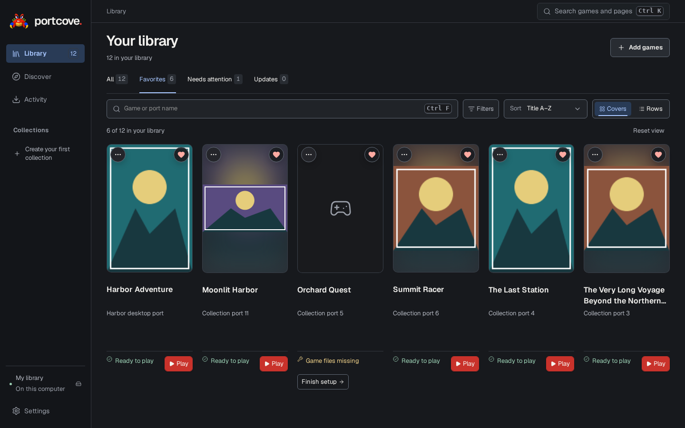
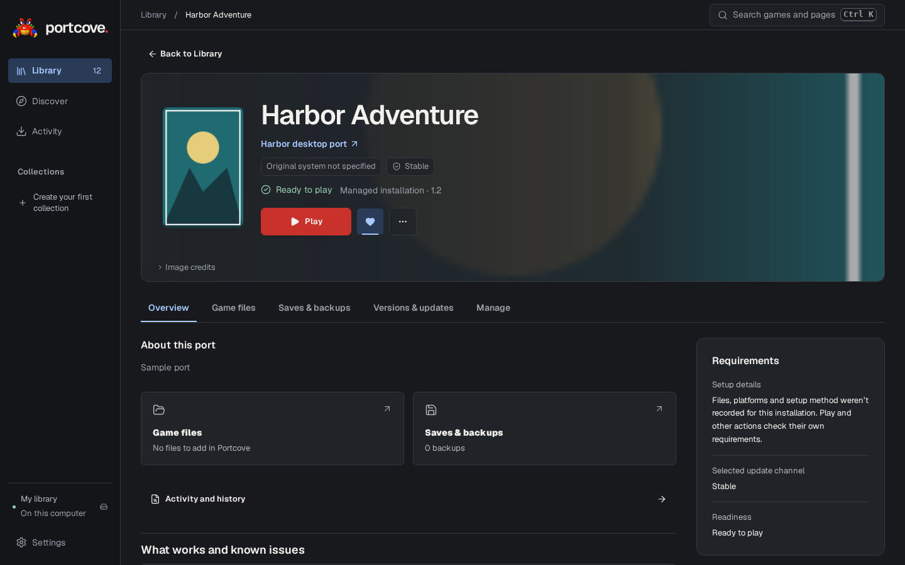

<h1 align="center">
  
</h1>

**Install, update, and play native game ports.** Portcove brings community-made
ports, including decompilations, recompilations, and engine recreations, into
one local library. Find a project for a game you own, see which edition it needs,
and launch it from the desktop app or a standalone command-line tool.

[Download Portcove](#download-portcove)
· [Browse the catalog](https://boburning.github.io/portcove/catalog/browse/index.html)
· [Set up your first game](#your-first-game)



_Portcove’s desktop interface with a simulated library of fictional games and geometric covers._ [Capture details](docs/media/readme/README.md)

<a id="project-status"></a>

## Download Portcove

Open [Portcove releases](https://github.com/boburning/portcove/releases) and
choose the release marked **Latest** when one is available. If only prereleases
are available, or if you want to try a preview, choose the newest
**Pre-release** whose tag starts with `v`. **Nightly** builds are for testing
recent changes. Read the notes for your system before installing, and use a new
or backed-up library when trying a preview.

Under **Assets**, choose the package for your computer.

| What you want       | Look for                                                                      |
| ------------------- | ----------------------------------------------------------------------------- |
| Windows desktop app | The x64 installer ending in `-setup.exe`                                      |
| Linux desktop app   | The `.AppImage` for your processor. Make it executable before opening.        |
| macOS desktop app   | The `.dmg`. A universal build runs on both Intel and Apple silicon.           |
| Command-line tool   | A `portcove-cli` archive for your operating system and processor, when listed |

Compare the download’s SHA-256 checksum with the entry for that filename in
the same release’s checksum file. The desktop app runs on its own. You only
need a CLI archive if you want to use Portcove from a terminal or another launcher.
You can also [follow release notes and nightlies in a feed reader](https://github.com/boburning/portcove/releases.atom).

<a id="download-the-technical-alpha"></a>

Looking for an older build? The [Alpha 2 packages](https://github.com/boburning/portcove/releases/tag/v0.1.0-alpha.2)
and the [Alpha 1 to Alpha 2 upgrade guide](docs/UPGRADING.md) are still available.

## Your first game

1. **Browse games.** Open Portcove Desktop and choose **Browse games** in the empty Library. Portcove has already selected a library folder. To use a different one, open **Settings → Library and storage → Choose another library**.
2. **Find a port in Discover.** Search for a game or project. Check its target operating system, the original game edition it accepts, and the setup instructions from the port authors.
3. **Supply the originals if needed.** Select the files from your own copy of the game. Portcove checks them on your computer. You can leave them where they are and save their location for reuse.
4. **Review the installation.** For a managed port, check the version and destination, then confirm the install. If the project provides its own installer or expects an existing installation, follow that route in the port’s details.
5. **Play from Library.** When the port is ready, choose **Play**. Some ports finish preparing their game data the first time they run.

Portcove does not supply ROMs, disc images, BIOS files, or commercial game data.
Your original files stay on your computer. You can use the library and launch
installed games without a Portcove or GitHub account.

## Catalog and support

One original game can have several independently maintained ports. When Discover
groups them, you can compare the editions they accept, where they run, and what
has been tested. A catalog entry may point you to the upstream project, help you
register an existing install, or offer an installation that Portcove can manage.
For an example, [compare the ports for Majora’s Mask in the live catalog](https://boburning.github.io/portcove/catalog/browse/games/the-legend-of-zelda-majoras-mask/index.html).



_Harbor Adventure in the same simulated library. Open a tab to find its game files, saves, or available updates._

## Manage, check, update and recover

- **Update a port.** For a managed install, review an available release and keep the previous version so you can switch back. An externally managed port uses its own update process.
- **Protect your saves.** Check which saves and settings a port declares. Portcove can back up and restore those files separately from the installed game. Keep a separate backup of your originals. [Saved data and backups](docs/CLI.md#managed-saved-data-and-backups)
- **Check or recover an install.** Run `portcove verify` with the port ID to check its installed files. After an interrupted task, open Activity or run `portcove doctor` to see what needs attention.
- **Try a different setup.** On the development branch, ports with reviewed mod support can keep a clean setup alongside a modded one. Each setup records the build and mod choices it uses. [Local profiles and mod packages](docs/CLI.md#local-profiles-and-mod-packages)

## Use the CLI

Desktop and the CLI normally open the same library. Opening a library can create its
database or upgrade it for this version. You can browse without writing local files
in the [web catalog](https://boburning.github.io/portcove/catalog/browse/index.html).

To try the CLI, run these commands from a folder where `portcove-demo` does not
already exist. They create a separate library there and show Lighthouse, a native
port of Banjo-Kazooie.

```sh
portcove --library "$PWD/portcove-demo" catalog list
portcove --library "$PWD/portcove-demo" catalog show lighthouse
```

If `portcove catalog --help` lists `listings`, run
`portcove --library "$PWD/portcove-demo" catalog listings` to include projects
you can explore upstream. `catalog list`
shows projects with installation definitions. Use `--json` when your script
needs structured output.
[CLI guide](docs/CLI.md) · [Connect another launcher](docs/INTEGRATIONS.md)

## Build from source

### Prerequisites

Install the [pinned Rust toolchain](rust-toolchain.toml) and its build prerequisites
for your operating system.

**Standalone CLI.** From the repository root, run:

```sh
cargo build --locked --release -p portcove-cli
```

The executable is in `target/release` unless you configured a different Cargo
target directory. See the [CLI build requirements](docs/CLI.md).

**Desktop.** Also install the pinned [Node](.node-version) and [pnpm](package.json)
versions and the [Tauri prerequisites for your platform](https://v2.tauri.app/start/prerequisites/).
Run `node scripts/dev-storage.mts preflight` from the repository root, then bootstrap
the frontend tools.

```powershell
# Windows
./scripts/bootstrap-quality-tools.ps1 -Profile frontend
```

```sh
# Linux or macOS
./scripts/bootstrap-quality-tools.sh --profile frontend
```

Start Desktop from the repository root.

```sh
node scripts/dev-storage.mts run -- pnpm --dir apps/desktop desktop:dev
```

[Development setup](docs/DEVELOPMENT-TOOLS.md#frontend-workflow) · [Documentation](docs/README.md)

## Contribute

To add or correct a port, start with the [catalog authoring guide](docs/CATALOG.md#adding-or-changing-a-port).
For a bug, include the Portcove version, operating system, port name, and the step
that failed. [Report an issue](https://github.com/boburning/portcove/issues/new/choose)
· [Contributing](CONTRIBUTING.md) · [Roadmap](https://github.com/users/boburning/projects/1)

Portcove uses AI-assisted development. The maintainer is responsible for changes
and releases. Portcove itself is available under the [MIT License](LICENSE-MIT)
or the [Apache License 2.0](LICENSE-APACHE), at your option.
