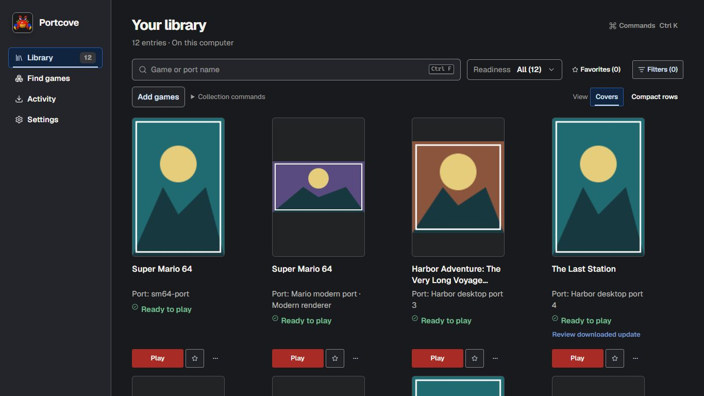
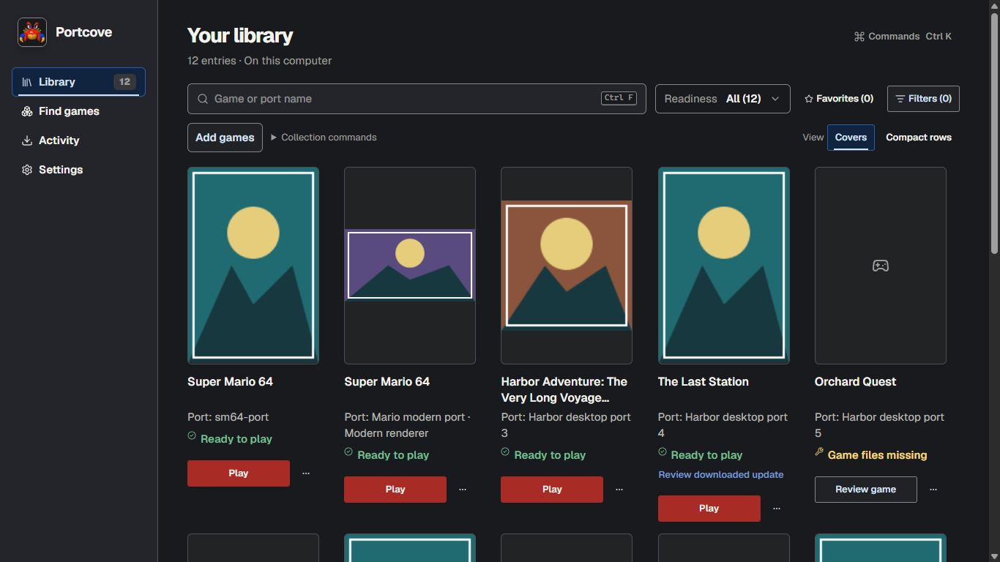
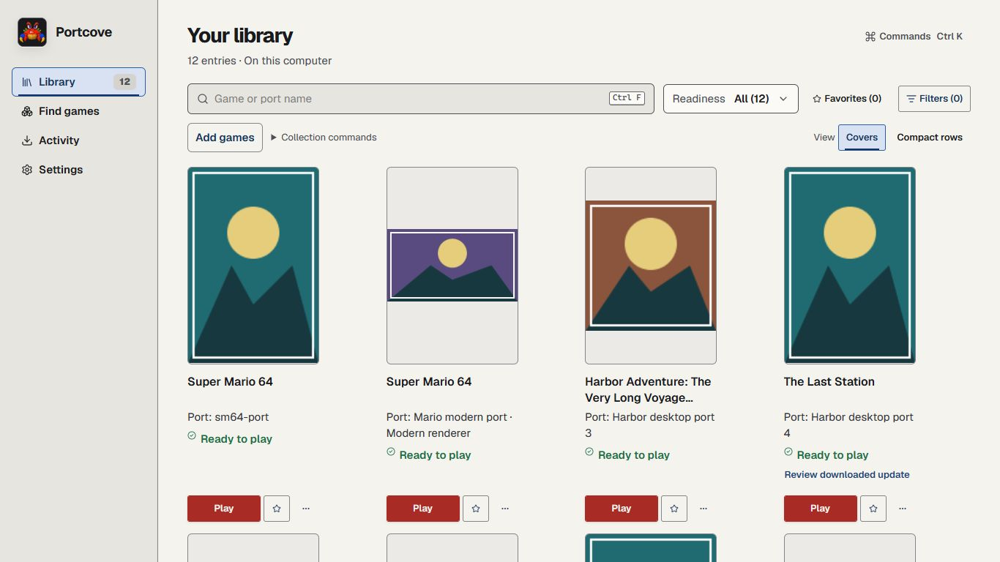
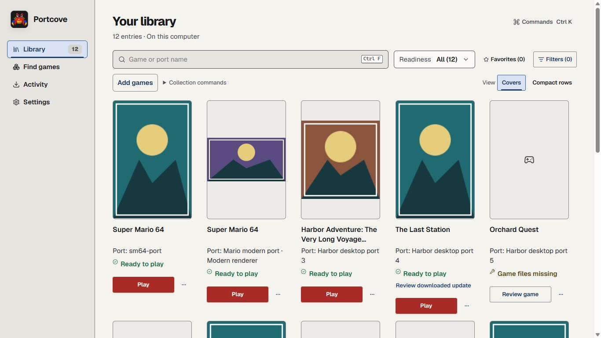
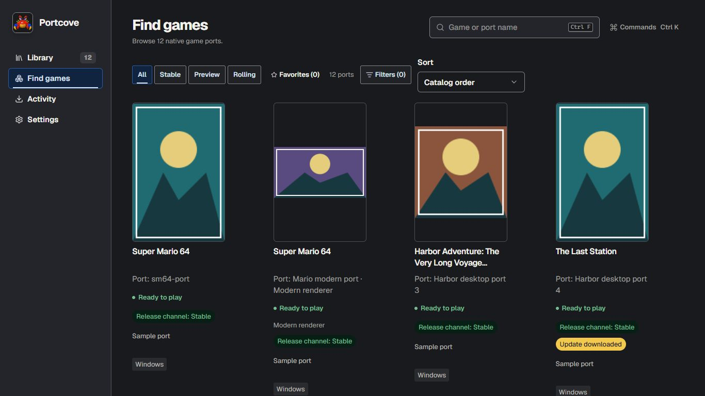
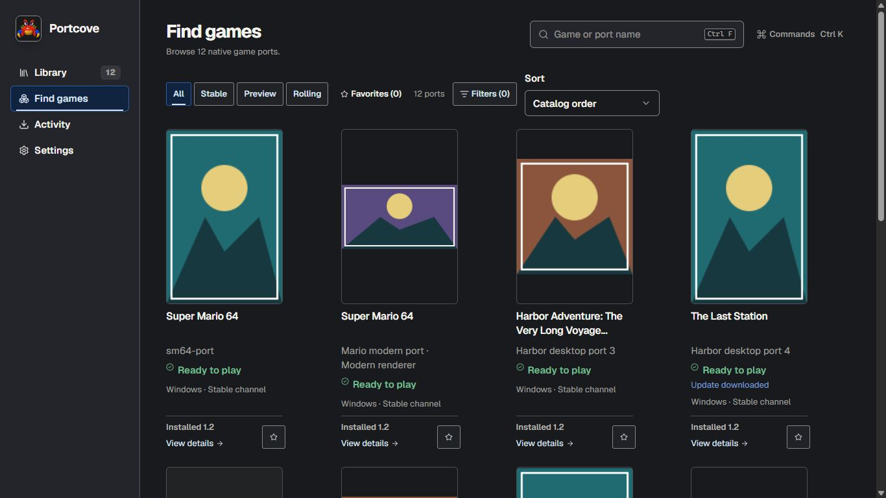

# UI audit refinements — issue #2412

This is the implementation of audit findings F1–F6, building on main `d21b70316e5add275b5468e54307b536f7126045`. Green checked readiness, direct authoritative Play, distinct port targets, existing installation/preparation/update/storage workflows, and existing preference owners are retained.

| Finding                             | Delivered change                                                                                                                                                     | Owning implementation                                   |
| ----------------------------------- | -------------------------------------------------------------------------------------------------------------------------------------------------------------------- | ------------------------------------------------------- |
| F1 Discovery density and repetition | One project/variant line; neutral platform/channel facts; no repeated summary; natural visible card name and linked setup/input descriptions                         | PortBrowser.tsx                                         |
| F2 Short-window Library density     | Adaptive 12rem/11rem card minimums below 800/680px height; 180/160px artwork caps; action follows its own entry state; Favorite is in More actions                   | PortBrowser.tsx, collection.css                         |
| F3 Narrow retrieval                 | Readiness takes its own line while Favorites and Filters share space; all existing filter groups, count/reset, view and command scope remain                         | PortBrowser.tsx, collection.css                         |
| F4 Add route language               | Review before continuing applies to preparing, copying and eligible external routes                                                                                  | AddGames.tsx                                            |
| F5 Lower detail repetition          | Compatibility facts stay visible; one Project and compatibility details disclosure holds project history and recorded checks; unknown update check is explained once | DetailPanel.tsx                                         |
| F6 Settings heading noise           | Removed redundant eyebrows; retained meaningful device/library scope in quiet sentence case; language feedback and controls preserved                                | Chrome.tsx, LanguageSettings.tsx, GameFileLibraries.tsx |

## Render evidence

All captures are actual production React UI with disposable interactive transport. Diagnostic artwork, readiness, paths and launch responses are simulated. No real game files were used. Images were individually inspected at full size. These are composition observations, not measured user-speed gains.

Matched Library conditions: collection fixture (12 entries), same artwork/order/readiness, dark or light theme, 1366×768, 16px root text, covers. Baseline audit captures are from `ea4dc2c38bafacac06419208a7441f943403cff5`; `git diff` proved no changes to apps/desktop/src, package.json or scenarios.html between that revision and pickup main. Original baseline identity is retained. Baseline showed four complete entries; revised shows five, with 180×270 artwork and all five actions within the viewport. Difficult cases include duplicate Super Mario titles, long identity, landscape/square/missing artwork and a downloaded update beside still-ready Play.

At 960×640, ordinary covers keep actions visible; the fourth entry's extra downloaded-update action requires a little scrolling. Rows show five complete entries and part of a sixth at the same size, keep full long identity and a 32×48 thumbnail. At 1600×1000 the list remains intentionally bounded while the workspace scrollbar follows the full available workspace. At 320px the page reflows vertically and navigation remains available; scrolling is expected.

## Verification

Focused final results and independent review are recorded on issue #2412 and its integration PR. The initial ten-file diagnostic run passed 217 tests and found two stale presentation assertions, subsequently corrected. Keyboard interaction through the actual browser confirmed menu navigation and Favorite removal focus restoration. Initial diagnostic failures and setup refusals are retained outside the repository. A typecheck passed for 1109 files. All 14 Library composition regressions and the full Favorites and Game-file libraries browser files passed in the next focused run (229 passing tests across four files, with one remaining unknown-channel assertion corrected afterward). Maintained native harness headings and version-fact expectations were updated to the new disclosure composition; this is source maintenance, not native execution. The first browser run could not launch because this checkout lacked the pinned headless browser; the maintained bootstrap subsequently installed and launched Chromium 156.0.8078.4. A queued bootstrap/typecheck source-change refusal and transient host identity-probe failures are not browser passes.

Native-host sizing is separate: the simulated browser transport truthfully refused a 200% sizing change and remained at 100%. Browser text-enlargement tests use the maintained layout harness. No installed/native package, actual screen reader, physical controller or real file/game-operation acceptance is claimed.

## Images

Matched baseline and revised production Library:

Matched discovery condition:

Further individually inspected captures: [short Library](library-dark-960.jpg), [short rows](rows-dark-960.jpg), [tall Library](library-dark-1600.jpg), [tall rows](rows-dark-1600.jpg), [narrow Library](library-narrow-dark.jpg), [light discovery](discovery-light-1366.jpg), [detail](detail-dark.jpg), [detail disclosure](detail-about-dark.jpg), [Appearance](settings-appearance-dark.jpg), [file settings](settings-files-light.jpg), and [Add games](add-games-dark.jpg).

## Final check follow-through

The component and maintained preparation-harness unit selection passed all 164 tests in both requested files. The seven shared installed-input/setup accessibility tests and four game-identity tests also passed after moving state checks to descriptions and retaining exact distinguishing names/IDs. The first hosted run [39875933336/1](https://github.com/boburning/portcove/actions/runs/39875933336) retained an old tooltip/name assertion in the identity test (820 other unit tests passed); the assertion was corrected, not the production identity behavior. Final exact-head required checks, independent repair review and delivery readback are recorded in PR #2416. Browser text-enlargement output from the maintained harness remains separate from native sizing.

## Accessibility and layout follow-through

The full browser run [39876598688/1](https://github.com/boburning/portcove/actions/runs/39876598688) found a real label-in-name mismatch in the initial short aria-label. The corrected card uses its lean visible identity/state/action as its natural name; hidden setup/input reasons remain explicit descriptions. This deliberately retains visible facts in the spoken name, following [WCAG Label in Name](https://www.w3.org/WAI/WCAG22/Understanding/label-in-name.html), rather than overriding the label for brevity. Legacy records without a distinct game title no longer repeat the same project name. The discovery captures were refreshed and individually inspected after this repair. Older geometry checks now require aligned artwork and actions connected to each entry's state, rather than equal action baselines; keyboard traversal reflects Favorite's menu placement. All earlier failed evidence remains retained.

The integrated repair run passed 227 checks across the twelve affected files and exposed one local cold-Windows outer-test timeout. The saved screenshot/trace shows Advanced filters already expanded when the old 15-second budget expired during click completion. Only that multi-dialog context journey now has a finite 60-second outer budget; assertions, product deadlines and zero-retry behavior remain. This is harness calibration, not a claimed product timing repair. Full lint/type checking passed for all 1109 files before that test-budget adjustment. Final results remain tied to the delivered PR head.
